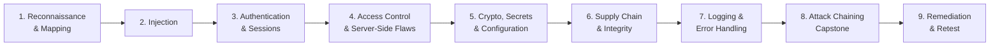

<div align="center">

# 🛡️ PolyVuln

### Polyglot + Vulnerable — Deliberately Insecure, Multi-Tech-Stack Web Applications for Security Training

*Learn to find, exploit, and fix real-world web vulnerabilities across the languages and frameworks used in modern enterprises.*

[](LICENSE)
[](https://owasp.org/Top10/)
[](#-getting-started)
[](#-deployment-options)
[](#%EF%B8%8F-legal-disclaimer)
[](CONTRIBUTING.md)

</div>

---

> [!CAUTION]
> **Everything in this repository is insecure by design.** The applications contain intentional, exploitable vulnerabilities. Never deploy them on a public network, a cloud host with a public IP, a corporate network, or any machine holding real data. Use them only in an isolated lab you own or are authorized to use.

---

## 📑 Table of Contents

- [About the Project](#-about-the-project)
- [Why PolyVuln?](#-why-polyvuln)
- [Who It's For](#-who-its-for)
- [What You'll Learn](#-what-youll-learn)
- [Vulnerability Coverage](#-vulnerability-coverage)
- [Technology Coverage](#-technology-coverage)
- [Key Features](#-key-features)
- [Difficulty Levels](#-difficulty-levels)
- [Deployment Options](#-deployment-options)
- [Getting Started](#-getting-started)
- [Learning Path](#-learning-path)
- [Contributing](#-contributing)
- [Legal Disclaimer](#%EF%B8%8F-legal-disclaimer)
- [License](#-license)

---

## 📖 About the Project

**PolyVuln** (*poly*glot + *vuln*erable) is a collection of realistic, intentionally vulnerable web applications built to train security professionals and developers in a safe, controlled environment.

Unlike single-page test harnesses, every lab in this repository behaves like a genuine business application — with dashboards, user roles, workflows, and data — so learners practice against the same complexity they will meet in real assessments. The labs are built on a mix of languages, frameworks, and databases, reflecting how modern organizations actually run their software: a blend of modern services and legacy systems connected across multiple trust boundaries.

Each lab ships with complete documentation, seed data, default accounts, a vulnerability matrix mapped to **OWASP Top 10:2025** and **CWE**, guided exercises, and secure-coding remediation guidance.

---

## 💡 Why PolyVuln?

| Challenge in Security Training | How PolyVuln Helps |
|---|---|
| Most practice apps use a single language | Labs span multiple tech stacks, so learners see how one flaw looks different in each |
| Toy apps feel unrealistic | Enterprise-style UIs, business logic, and multi-service architectures |
| Findings are taught in isolation | Exercises include chaining weaknesses into full attack paths |
| Offensive training ignores the fix | Every vulnerability includes remediation guidance and retest steps |
| Labs are hard to set up | One-command startup with Docker, plus Kubernetes and VM options |

---

## 👥 Who It's For

- 🎓 **Students** learning web application security fundamentals
- 🛡️ **AppSec engineers** practicing secure code review and remediation
- 🔴 **Penetration testers and red teams** sharpening methodology and chaining skills
- 🔵 **Blue teams** generating realistic attack telemetry for detection engineering
- 🏁 **CTF organizers** needing ready-made challenge environments
- 🏢 **Security awareness teams** running hands-on developer workshops

---

## 🎯 What You'll Learn

By working through the labs, participants will be able to:

1. Identify and validate every category of the OWASP Top 10:2025 in a live application.
2. Recognize how the same vulnerability class appears across different languages and frameworks.
3. Map findings to CWE identifiers and write professional, evidence-backed reports.
4. Chain individual weaknesses into realistic, high-impact attack paths.
5. Apply secure coding fixes and prove they work through retesting.
6. Use industry-standard tools for proxying, static analysis, dependency scanning, and secrets detection.

---

## 🔍 Vulnerability Coverage

Every lab contains a fixed baseline of vulnerabilities covering all ten **OWASP Top 10:2025** categories.

| OWASP 2025 Category | Example Weakness Classes |
|---|---|
| **A01** Broken Access Control | Path traversal, CSRF, directory listing, SSRF, secrets in source comments |
| **A02** Security Misconfiguration | Insecure defaults, exposed environment variables, missing cookie flags |
| **A03** Software Supply Chain Failures | Outdated and vulnerable third-party components |
| **A04** Cryptographic Failures | Cleartext transmission, weak or reversible hashing |
| **A05** Injection | SQL injection, command injection, reflected and stored XSS |
| **A06** Insecure Design | Incorrect privilege assignment, clickjacking |
| **A07** Authentication Failures | Improper authentication, single-factor auth, session fixation, weak password recovery |
| **A08** Software or Data Integrity Failures | Unsafe deserialization and unverified data integrity |
| **A09** Security Logging & Alerting Failures | Sensitive data written to logs, missing security alerts |
| **A10** Mishandling of Exceptional Conditions | Verbose errors, fail-open error handling |

Detailed, per-vulnerability documentation lives inside each lab's own folder.

---

## 🧰 Technology Coverage

The labs collectively span a broad range of technologies:

| Layer | Technologies |
|---|---|
| **Backend** | Node.js / Express, Python / Flask & Django, PHP / Laravel, Java / Spring Boot, ASP.NET Core |
| **Frontend** | React, Vue, Bootstrap, Tailwind CSS, jQuery, Alpine.js |
| **Databases** | MySQL, PostgreSQL, SQLite, MongoDB, Redis |
| **Infrastructure** | Docker, Docker Compose, Kubernetes, Nginx, Apache |

---

## ✨ Key Features

- 🏢 **Realistic business applications** with professional, responsive dashboards and charts
- 🌐 **Multi-stack architectures** with services communicating across trust boundaries
- 📋 **Complete vulnerability matrices** mapped to OWASP and CWE
- 🧪 **Guided lab exercises** with learning objectives and verification procedures
- 🛠️ **Remediation guidance** and secure reference implementations for comparison
- 🎚️ **Configurable difficulty levels** from beginner to expert
- 🌱 **Synthetic seed data** and default accounts so every lab works immediately
- 🔄 **One-command reset** to return any lab to a clean state between sessions

---

## 🎚️ Difficulty Levels

| Level | Audience | What to Expect |
|---|---|---|
| 🟢 **Beginner** | Students, first-time learners | Obvious flaws, verbose errors, helpful hints |
| 🟡 **Intermediate** | Practitioners, internal training | Flaws hidden in business workflows, simple filters to bypass |
| 🟠 **Advanced** | Penetration testers, red teams | Partial mitigations, chaining required across services |
| 🔴 **Expert** | Mature offensive teams | Multi-stage paths, infrastructure and service-to-service trust in scope |

---

## 📦 Deployment Options

| Mode | Best For | Startup |
|---|---|---|
| 🐳 **Docker Compose** | Individual learners, quick setup | Single command |
| ☸️ **Kubernetes** | Team labs, expert-level scenarios | Minikube, Kind, k3s, or local clusters |
| 🖥️ **Local VM** | Offline or air-gapped classrooms | Installer scripts for Ubuntu, Debian, Rocky Linux, CentOS, Windows Server |

All deployments bind to `127.0.0.1` by default so the labs are not reachable from other machines.

---

## 🚀 Getting Started

### Prerequisites

- Docker Engine 24+ and Docker Compose v2
- 8 GB RAM recommended
- Git
- An isolated environment (a dedicated VM with host-only or NAT networking is ideal)

### Clone the Repository

```bash
git clone https://github.com/loursha/PolyVuln-Web-Application-Labs.git
cd PolyVuln-Web-Application-Labs
```

Then open the lab of your choice and follow the setup instructions in its own README.

> [!TIP]
> Take a VM snapshot before you start so you can roll back to a clean state at any time.

---

## 🗺️ Learning Path



**Recommended tooling:** Burp Suite or OWASP ZAP, sqlmap, ffuf, Semgrep, Trivy, OWASP Dependency-Check, Gitleaks, Wireshark, and hashcat (against lab data only).

---

## 🤝 Contributing

Contributions are welcome — new labs, additional tech stacks, exercises, documentation improvements, and translations.

1. Fork the repository and create a feature branch.
2. Document every intentional vulnerability with its OWASP category, CWE, and remediation.
3. Make sure the lab starts cleanly from scratch with a single command.
4. Open a pull request describing the scenario and its learning objectives.

See [CONTRIBUTING.md](CONTRIBUTING.md) for full guidelines.

> [!NOTE]
> Please don't report the intentional vulnerabilities as security issues. If you find an **unintended** flaw that lets a lab affect the host system, report it privately as described in [SECURITY.md](SECURITY.md).

---

## ⚖️ Legal Disclaimer

This project is provided **solely for education, authorized security training, and research**.

- ✅ Run the labs only on systems you own or are explicitly authorized to use.
- ✅ Keep them on an isolated network.
- ❌ Never expose them to the internet or a shared network.
- ❌ Never use techniques practiced here against any system without written permission.

The authors and contributors accept **no liability** for misuse or for damage caused by running this software. Unauthorized access to computer systems is illegal in most jurisdictions.

---

## 📄 License

Distributed under the **MIT License**. See [LICENSE](LICENSE) for details.

---

## 🙏 Acknowledgments

- [OWASP Top 10](https://owasp.org/Top10/) and the [OWASP Web Security Testing Guide](https://owasp.org/www-project-web-security-testing-guide/)
- [MITRE CWE](https://cwe.mitre.org/)
- Inspired by OWASP Juice Shop, DVWA, and WebGoat

<div align="center">

**Built for defenders who learn by breaking things — safely.**

⭐ If these labs help your team, consider starring the repository.

</div>
